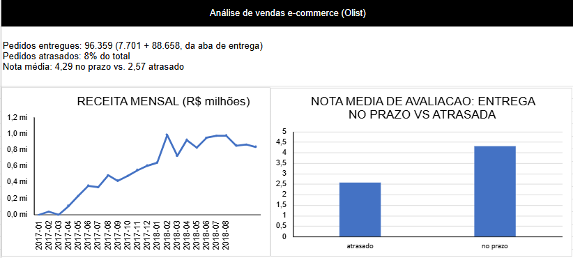
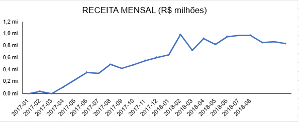
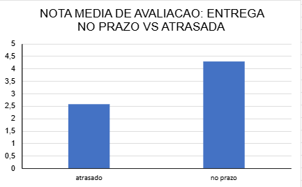

# Análise de Vendas E-commerce (Olist)

## Objetivo
Analisar vendas, categorias, ticket médio e entregas de um e-commerce
brasileiro para identificar oportunidades de negócio.

## Dados
Dataset público Olist (Kaggle): cerca de 96 mil pedidos entregues,
de 2016 a 2018.

## Ferramentas
SQL (consultas e window functions) e Excel (tabelas e gráficos).

## Perguntas respondidas
- Como evoluiu a receita mês a mês?
- Quais categorias geram mais receita?
- Qual o ticket médio por estado?
- O atraso na entrega afeta a avaliação do cliente?

## Principais insights
1. A receita cresceu em 2017 e se estabilizou em torno de R$ 0,9 a 1 milhão
   por mês em 2018, com pico em novembro de 2017 (+52%, possível efeito de
   Black Friday).
2. health_beauty e watches_gifts lideram a receita (cerca de R$ 1,2 milhão
   cada), e não há dependência de uma única categoria.
3. O ticket médio é mais alto no Norte e Nordeste (PB: R$ 216,67).
   Estados com poucos pedidos podem ter médias distorcidas.
4. Apenas 8% dos pedidos chegam atrasados, mas a nota média deles é 2,57,
   contra 4,29 dos entregues no prazo.

## Limitações
- Os primeiros meses de 2016 têm poucos pedidos e o último mês da base
  pode estar incompleto.
- Os resultados mostram associação, não causalidade.

## Como reproduzir
1. Importar os CSVs do dataset em um banco SQL.
2. Rodar as consultas de `consultas.sql`.
3. Abrir `analise_vendas.xlsx`.

## Prévia

   
   
